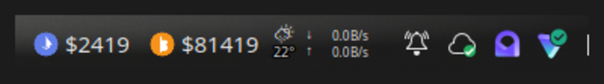
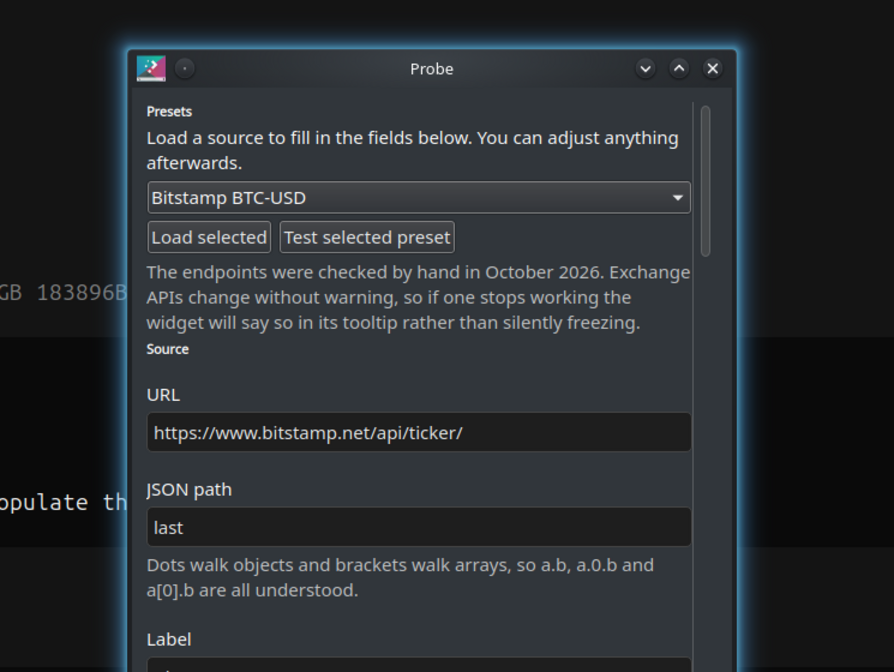
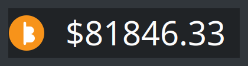

<!--
  SPDX-FileCopyrightText: 2026 xcompanero
  SPDX-License-Identifier: CC-BY-SA-4.0
-->

# Crypto Price — a Plasma 6 widget

A Plasma 6 / Qt 6 port of
[spmdrd/plasma-applet-cryptocurrency-price](https://github.com/spmdrd/plasma-applet-cryptocurrency-price),
which was Plasma 5 only and has not been maintained since 2020.

The idea is unchanged: rather than hardcoding a list of exchanges, you give
the widget **any URL** and **any JSON path**, and it shows you that number.

```
URL:          https://api.kraken.com/0/public/Ticker?pair=XBTUSD
JSON path:    result.XXBTZUSD.c[0]
                              ↓
                        $81,912.30
```







## News

### This is a Plasma 6 port — the original is Plasma 5 only

If you came here from
[spmdrd/plasma-applet-cryptocurrency-price](https://github.com/spmdrd/plasma-applet-cryptocurrency-price),
that widget stopped working on Plasma 6 and has had no updates since 2020.
This is the same widget, ported and put back on working order. The idea is
unchanged: **give it any URL and any JSON path**, and it shows you that number.

```sh
kpackagetool6 --type Plasma/Applet --install cryptoprice.plasmoid
```

**The same features** — arbitrary source URL and JSON path, three-stage
multiplication (base price × conversion factor × conversion factor × an amount
you hold), decimal places, prefix and suffix, tooltip, custom icons, background
toggle, and a preset list.

**What's fixed**

- **The timeout never worked.** The original set `xhr.timeout`, which QML's
  `XMLHttpRequest` has no member for, so it was silently ignored. Requests are
  now bounded by a real watchdog timer.
- **A failed request left a spinner on screen forever.** The old code cleared
  its busy flag only on HTTP 200. Every failure path is handled now, the cause
  is named in the tooltip, and the last good price stays visible.
- **The arithmetic ran on strings.** The price was a string property multiplied
  inside a text binding, so every re-evaluation re-multiplied an
  already-rounded value. It is now computed as a number.
- **JSON paths could not walk arrays.** `a[0].b`, `a.0.b` and `a.b` are all
  understood now; the old tokenizer turned `data[0].price` into `data0`.
- **Half the presets were dead.** Bittrex v1.1, BTCC, the CoinMarketCap v1 API,
  the LocalBitcoins average endpoint and Poloniex no longer answer — and
  fixer.io, the old *default* fiat source, returns 404, so currency conversion
  did not work out of the box. Every preset shipped here was checked by hand in
  October 2026, and each has a **Test connection** button so a source that
  rots is diagnosed in the config dialog instead of by watching a stale panel.
- **It refreshes every 30 minutes** by default rather than 10, which is kinder
  to exchange API rate limits.

## Installing

Nothing needs to be compiled.

```sh
kpackagetool6 --type Plasma/Applet --install cryptoprice.plasmoid
```

Or from a clone:

```sh
kpackagetool6 --type Plasma/Applet --install package
```

Then right-click a panel → **Add Widgets** → **Crypto Price**.

To build a distributable archive:

```sh
cd package && zip -r ../cryptoprice.plasmoid . && cd ..
kpackagetool6 --type Plasma/Applet --upgrade cryptoprice.plasmoid
```

There is a `CMakeLists.txt` for the usual `make install` route, but it only
needs Extra CMake Modules — the widget itself is pure QML.

### Development

```sh
sudo apt install plasma-workspace-dev qt6-declarative-dev-tools
plasmoidviewer --applet com.github.xcompanero.cryptoprice
```

With no dev packages installed, `python3 tools/check-config.py` still catches
the config-page mistakes that are otherwise silent — a `cfg_` alias pointing at
an id that doesn't exist makes the whole page fail to load and come up blank,
with the only trace being one line in the journal.

`plasmoidviewer` is much better than install-and-reload: no panel juggling,
and QML warnings go to the terminal.

### Changes will not appear until plasmashell restarts

This is the single most misleading thing about developing a QML applet, and
it cost a lot of time here.

**plasmashell caches compiled QML units in memory, keyed by URL, for the
lifetime of the process.** Edit a `.qml` file, run
`kpackagetool6 --upgrade`, remove the widget and add it back — and you get a
faithful render of the code as it was *when that file was first compiled*.
Later edits are simply not there.

Clearing `~/.cache/plasmashell/qmlcache` does **not** help; that is the
on-disk cache, not the in-memory one. You need:

```sh
systemctl --user restart plasma-plasmashell
```

The tell is a comparison between two processes: if `plasmawindowed` (fresh)
renders your change correctly while the panel (long-running) does not, you are
looking at stale code, not a bug in your QML. Check that before debugging.

Note that this also means applet QML `console.log`/`console.warn` is not a
reliable diagnostic here — those lines did not reach `journalctl --user` in
testing, so measuring the result on screen (a distinctive background, say) is
more dependable than logging.

## What it does

- Any HTTPS endpoint returning JSON, with any JSON path
- Three-stage multiplication: base price × conversion factor × conversion
  factor × an amount you hold
- Icon: nine bundled coin glyphs, or your own image file; prefix/suffix,
  decimal places, label, background
- Tooltip showing the price, what you hold, when it was last updated, and
  any error
- Refresh from 1 minute to 24 hours; **defaults to 30**, because exchange
  APIs rate-limit and freshness beyond that costs you nothing but accuracy
- **Test connection** in the config dialog, for every source and every
  conversion factor
- Right-click for *Refresh now* and *Open source in browser*

## Configuration

Two pages: **General** (source, presets, updates, appearance) and
**Conversion** (holding amount, second and third multiplication stages).

JSON paths accept every syntax you are likely to paste:

| Path | Means |
|---|---|
| `last` | top-level key |
| `data.closing_price` | nested object |
| `0.price_usd` | first element of an array |
| `result.XXBTZUSD.c[0]` | brackets walk arrays |
| `data[0].price` | mixed |

## Differences from the Plasma 5 original

The port was deliberately faithful to the feature set, but not to the
implementation. These were real bugs, not preferences:

1. **The timeout never worked.** The old widget set `xhr.timeout = 5000`,
   but QML's `XMLHttpRequest` has no `timeout` member, so it was silently
   ignored. `RateFetcher.qml` uses a watchdog `Timer` and `abort()`.

2. **A failed request left a spinner on screen forever.** The old code
   cleared its busy flag only on HTTP 200, and had no error state at all.
   Here every path clears `busy`, failures are named in the tooltip, and the
   last good price stays visible instead of vanishing.

3. **The arithmetic was done on strings.** `cryptoRate` was a string
   property and the multiplication happened inside a `text` binding, so every
   re-evaluation re-multiplied an already-rounded value. The price is now
   computed as a number in `recompute()` and the binding only reads it.

4. **The icon picker is gone from Qt 6.** `KQuickAddons.IconDialog` no longer
   exists, so there is a bundled-glyph picker instead.

5. **Roughly half the presets were dead.** Bittrex v1.1, BTCC, the
   CoinMarketCap v1 API, the LocalBitcoins average endpoint and Poloniex all
   fail now. fixer.io — the *default* fiat source — returns 404, so the
   conversion feature did not work out of the box. All endpoints shipped here
   were checked by hand in October 2026, and the fiat defaults are
   `open.er-api.com` and Frankfurter, both free and keyless.

6. **No guard on the refresh interval.** The old timer multiplied the
   configured value straight into its interval, so `0` was a hot loop.

Plasma 6 API changes: `compactRepresentation` is a `Component`,
`plasmoid.setAction()` became `Plasmoid.contextualActions`, QtQuick.Controls 1
became Controls 2, and the config UI moved to `org.kde.plasma.configuration`.

### Things that are missing on Plasma 6.6 (and Ubuntu 26.04 specifically)

Worth knowing before you go looking for them:

| Type | Status on Plasma 6.6 / Ubuntu 26.04 | Consequence |
|---|---|---|
| `PlasmaCore.IconItem` | gone — `org.kde.plasma.quick` is not installed | custom icons are **image paths**, not theme names |
| `PlasmaComponents.Heading` | gone — `Heading.qml` missing from the package | bold `Label` instead |
| `PlasmaCore.Theme` | resolves as a type but is **undefined** as a value | `Kirigami.Theme` used instead |
| `Plasmoid.CompactRepresentation` | **undefined** | `preferredRepresentation` left unset |
| `KQuickAddons.IconDialog` | gone since Qt 6 | bundled-glyph picker instead |
| `.js` auto-import from the same directory | does not resolve | explicit `import "priceutils.js" as PriceUtils` |

Referencing any of the missing ones makes the widget fail to load outright,
so the code avoids all of them. Custom icons therefore take a path such as
`/home/you/btc.svg`, which is what the original widget's README recommended
anyway ("download the respective coin images from coinranking.com").

## Layout

```
package/
├── metadata.desktop
└── contents/
    ├── config/
    │   ├── config.qml        # ConfigModel: the two categories
    │   └── main.xml          # kcfg schema
    ├── ui/
    │   ├── main.qml          # PlasmoidItem, fetchers, timer, tooltip
    │   ├── RateFetcher.qml   # one HTTP fetch, with honest failure states
    │   ├── TickerRow.qml     # icon + label + price, shared by both reps
    │   ├── priceutils.js     # JSON path resolution, number formatting
    │   └── config/
    │       ├── General.qml
    │       ├── Conversion.qml
    │       ├── SourceTester.qml
    │       └── presets.js
    └── images/coins/*.svg
```

`RateFetcher.qml` is deliberately self-contained, behind a small interface
(`url`, `jsonPath`, `updated`, `failed`). If you ever need real HTTP
semantics — HTTP/2, redirect policy, a request cache — a C++ backend using
`QNetworkAccessManager` can replace it without touching `main.qml`.

## Credits and licence

**This project is a Plasma 6 port of
[spmdrd/plasma-applet-cryptocurrency-price](https://github.com/spmdrd/plasma-applet-cryptocurrency-price)
by Spmdrd**, which is MIT licensed.

MIT permits relicensing under the GPL, so this port is distributed under
**GPL-3.0-or-later** with the original MIT notice retained — see `NOTICE`, which
also records two details about the upstream worth knowing:

- it declares `X-KDE-PluginInfo-License=MIT` but ships no MIT licence text;
- one of its files (`IconPicker.qml`) was GPL-2.0-or-later, not MIT. That file
  built on `KQuickAddons.IconDialog`, which Qt 6 removed, and it was **not**
  carried over — so no GPL-2.0-or-later code travels with this work.

Coin glyphs in `contents/images/coins/` are original geometric marks rather
than project logos, which keeps asset licensing simple.

| Part | Licence |
|---|---|
| QML, JavaScript, `main.xml` | GPL-3.0-or-later |
| Coin glyphs | GPL-3.0-or-later |
| `CMakeLists.txt` | BSD-2-Clause — KDE's licensing policy requires CMake code to use a BSD licence |
| `README.md`, `CHANGELOG.md` | CC-BY-SA-4.0 |

Full texts are in `LICENSES/`, per the REUSE specification. `LICENSE` is the
GPL-3.0 text, so GitHub displays it.

GPL affects redistribution, not use: you can run this freely, and anyone you
give it to must pass on the source and keep their modifications under the same
terms.
